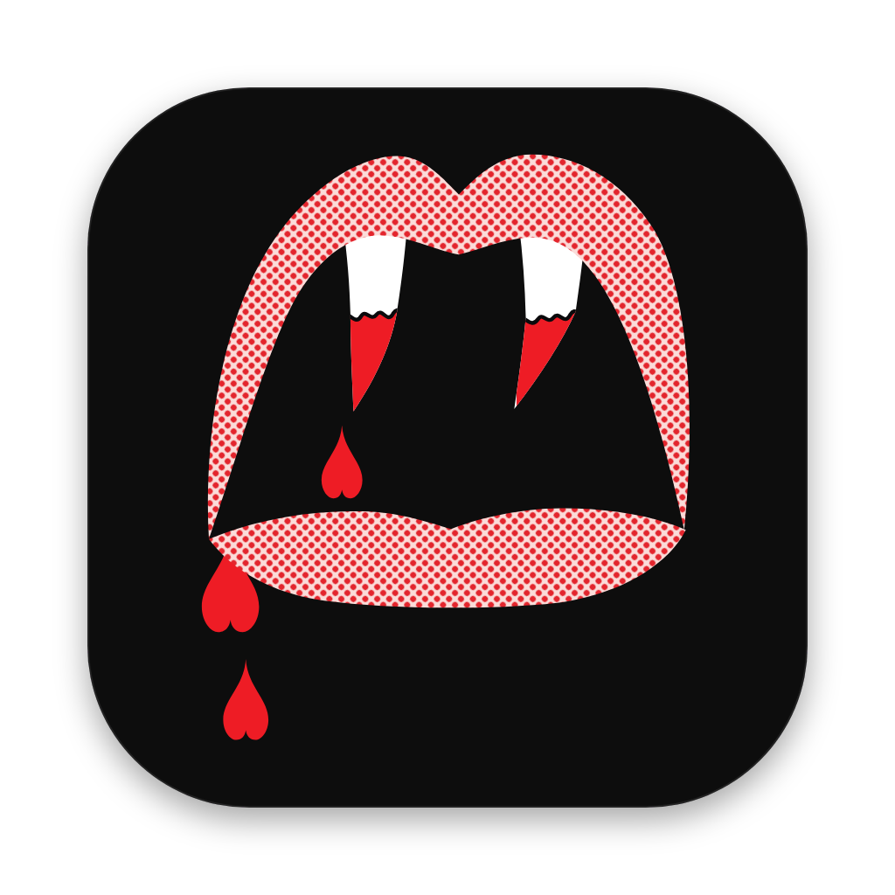

<p align="center">
  
</p>

<h1 align="center">H.A.T.E.</h1>

<p align="center">
  A macOS-style terminal for Windows, with tabs, Dracula colors and WSL support.<br>
  Built with Tauri and xterm.js.
</p>

## Features

- **See-through window** with rounded corners and adjustable transparency
- **Real traffic lights:** the green light goes full screen, and Alt+click maximizes
- **Tabs** styled after Terminal on macOS Tahoe, with drag to reorder
- **zsh (WSL), PowerShell and CMD**, each tab running in its own ConPTY
- **Drop a file** on the window to insert its path, in the right format for that shell
- **Clickable links**, including OSC 8 hyperlinks
- **Live settings** for transparency, corners, font, cursor, bell and shell commands

## Requirements

- Windows 10 or 11 with [WebView2](https://developer.microsoft.com/microsoft-edge/webview2/)
- [WSL](https://learn.microsoft.com/windows/wsl/install) for the default zsh tab. You can set any other shell in Settings.
- A [Nerd Font](https://www.nerdfonts.com/) is optional. The default is FiraCode Nerd Font Mono, and the bundled JetBrainsMono Nerd Font is the fallback.

## Build

There are no prebuilt releases yet, so build it from source. You need [Node.js](https://nodejs.org/) 18+, [Rust](https://rustup.rs/) and the MSVC build tools. Run this from a Windows folder, not a WSL path:

```powershell
npm install
npm run tauri build
```

The installers end up in `src-tauri/target/release/bundle/` (`.exe` and `.msi`).

## Keyboard shortcuts

| Keys | Action |
|---|---|
| Ctrl+T or Ctrl+Shift+T | New tab with the default shell |
| Ctrl+Shift+1 / 2 / 3 | New zsh / PowerShell / CMD tab |
| Ctrl+Shift+W | Close tab |
| Ctrl+Tab / Ctrl+Shift+Tab | Next / previous tab |
| Ctrl+1 to Ctrl+8 | Go to that tab |
| Ctrl+9 | Go to the last tab |
| Ctrl+Shift+C | Copy |
| Ctrl+V or Ctrl+Shift+V | Paste |
| Ctrl+= / Ctrl+- / Ctrl+0 | Font bigger / smaller / reset |
| Ctrl+, | Settings |

## Mouse

| Action | Result |
|---|---|
| Click the ≡ menu | New tab or Settings |
| Click a link | Open it in the default browser |
| Drop a file on the window | Insert its path in the active tab |
| Drag a tab | Reorder tabs |
| Middle-click a tab | Close it |
| Double-click the title bar | Maximize |
| Click the green light | Full screen |
| Alt+click the green light | Maximize |

## Customize

Most options are in ≡ → Settings and save automatically. For anything else:

| What | Where |
|---|---|
| Terminal colors | `DRACULA` in `src/main.js` |
| Window and tab colors | `src/style.css` |
| Shell profiles | `PROFILES` and `DEFAULTS.commands` in `src/main.js` |
| Icon | Edit `app-icon.svg`, render it to `app-icon.png` (1024×1024), then run `npx tauri icon app-icon.png` |

## Development

```powershell
npm run tauri dev
```

Running `npm run dev` alone opens a browser preview with fake output, which is handy for CSS work.

| File | What it does |
|---|---|
| `src/main.js` | Tabs, xterm, settings and shortcuts |
| `src/style.css` | Window, title bar, tabs and settings panel |
| `src-tauri/src/main.rs` | One PTY per tab, using portable-pty |
| `src-tauri/tauri.conf.json` | Frameless, transparent window |

The bundled font is JetBrainsMono Nerd Font, under the SIL Open Font License (see `public/fonts/OFL.txt`).
